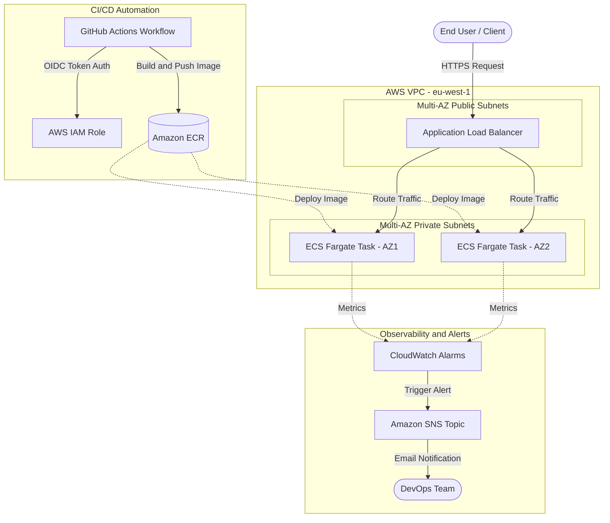
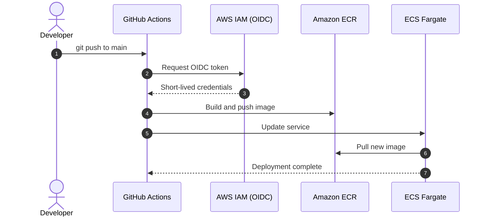
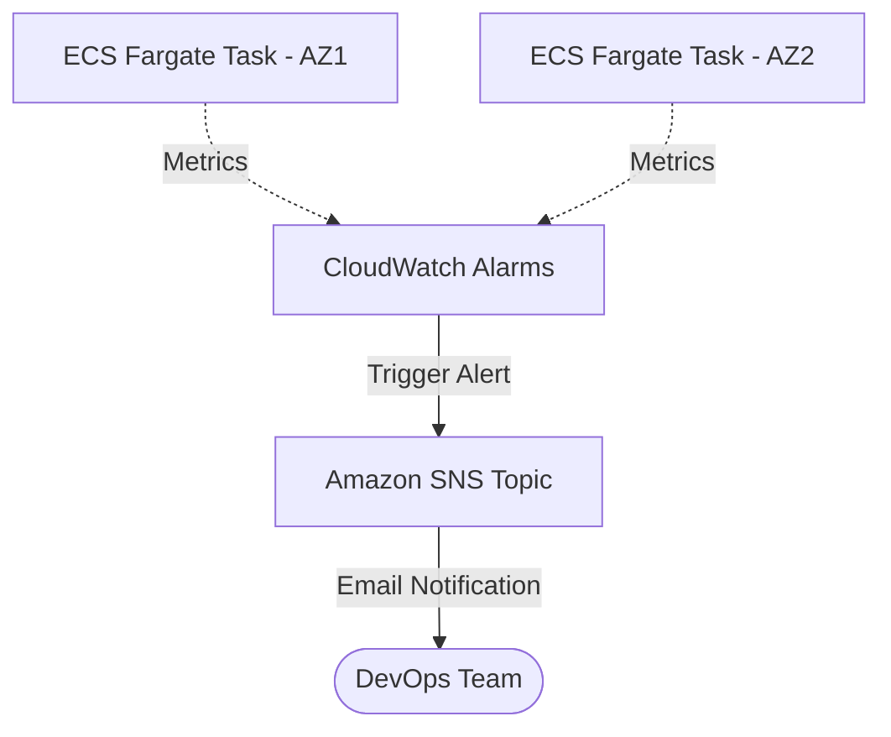

<div align="center">

# 🚀 AWS ECS Fargate: CI/CD & Monitoring

**Keyless, fully automated container delivery on AWS, provisioned as code.**


</div>

---

## 📌 Overview

A production-style reference implementation that takes a containerized web app from `git push` to a **highly available, monitored deployment on AWS ECS Fargate**. Infrastructure is 100% Terraform, authentication is 100% keyless (GitHub OIDC), and failures are reported by email before users notice.

| | |
|---|---|
| **Compute** | AWS ECS Fargate (serverless containers), 2 Availability Zones |
| **Networking** | Custom VPC, public subnets (ALB), private subnets (tasks) |
| **CI/CD** | GitHub Actions with OIDC, no stored AWS keys |
| **Registry** | Amazon ECR |
| **Observability** | CloudWatch Alarms, SNS email notifications |
| **IaC** | Terraform |

---

## 💡 The Problem & The Solution

Small teams often deploy by hand: build an image on a laptop, copy it to a server, paste secrets into config files, and find out the app is down when a customer complains.

| Before | After |
|---|---|
| Manual deploys | Every push to `main` builds, tests, and deploys automatically |
| AWS access keys stored in CI | Short-lived credentials via GitHub OIDC (no stored keys) |
| Click-built infrastructure | Everything defined in Terraform and reproducible |
| "We'll notice if it breaks" | CloudWatch alarms send an email through SNS |

---

## 🏗️ Architecture



**How to read it**

- 🔵 **Delivery path:** GitHub Actions authenticates to AWS through OIDC, builds the image, and pushes it to ECR. ECS pulls it and rolls out the new tasks.
- 🟢 **Request path:** users reach the Application Load Balancer in the public subnets. The ALB forwards traffic to Fargate tasks in private subnets across two AZs.
- 🔴 **Alert path:** task metrics feed CloudWatch Alarms. When an alarm fires, SNS emails the DevOps team.

---

## 🔄 CI/CD Pipeline



---

## 🔐 Security by Design

| Control | Implementation |
|---|---|
| **No long-lived secrets** | GitHub OIDC replaces static AWS access keys |
| **Network isolation** | Tasks run in private subnets with no public IP |
| **Single entry point** | Only the ALB is internet-facing |
| **Least privilege** | The CI role is limited to what the pipeline needs |
| **Resilience** | Tasks spread across two Availability Zones |

---

## 📊 Monitoring & Alerting



Alarms watch service health. When a threshold is breached, SNS sends an email so the team reacts before customers report the issue.

---

## 📁 Repository Structure

```text
.
├── .github/workflows/    # CI/CD pipeline
├── app/                  # Application source and Dockerfile
├── terraform/            # VPC, ALB, ECS, ECR, IAM, CloudWatch, SNS
└── README.md
```

---

## ⚡ Quick Start

**Prerequisites:** AWS account, AWS CLI, Terraform, Docker, a GitHub repository.

```bash
cd terraform
terraform init
terraform validate
terraform plan
terraform apply
```

Push to `main` to trigger the pipeline:

```bash
git push origin main
```

**Tear down** (to avoid unnecessary costs):

```bash
cd terraform && terraform destroy
```

---

## 🗺️ Roadmap

- [ ] HTTPS with ACM certificate and custom domain
- [ ] Auto Scaling on CPU and request count
- [ ] Remote Terraform state (S3 + locking)
- [ ] Container and IaC security scanning in CI
- [ ] Blue/green deployments

---

## 👥 Authors

[@achh-914](https://github.com/achh-914) · [@meriem-achh](https://github.com/meriem-achh)
